# Reference library

These examples establish the skill's visual language: precise character
geometry, sparse composition, quiet structure, semantic accents, and stepped
changes that explain a concept. Read the bundled images first, then open the
complete payload for the relevant construction or motion. Carry that language
into new subjects and brands. Original Figma access is optional; every image
and JSON file below is in this repository.

## Choose a reference

The examples demonstrate different ways to explain a change with characters.

| Example                      | Transferable idea                                                                      | Full source readout                                                          | Native PNG                                                                  |
| ---------------------------- | -------------------------------------------------------------------------------------- | ---------------------------------------------------------------------------- | --------------------------------------------------------------------------- |
| Transformation               | A recognizable object changes internally while its surroundings stay stable.           | [processor.json](figma/processor.json)                                       | [processor.png](images/processor.png)                                       |
| Parallel activity            | Distinct actions overlap while their routes and identities remain readable.            | [parallel-transformation.json](figma/parallel-transformation.json)           | [parallel-transformation.png](images/parallel-transformation.png)           |
| State and conflict           | Repeated rows establish a comparison; text and color reveal a different state.         | [state-conflict.json](figma/state-conflict.json)                             | [state-conflict.png](images/state-conflict.png)                             |
| Focus and resolution         | A sequence expands one subject, shows a change, and returns to the larger composition. | [state-resolution.json](figma/state-resolution.json)                         | [state-resolution.png](images/state-resolution.png)                         |
| Distinct processing roles    | Different character glyphs explain different work inside a shared routing structure.   | [use-case-processors.json](figma/use-case-processors.json)                   | [use-case-processors.png](images/use-case-processors.png)                   |
| Throughput comparison        | Character traces compare measurements on shared axes, with staged reveals.             | [throughput-comparison.json](figma/throughput-comparison.json)               | [throughput-comparison.png](images/throughput-comparison.png)               |
| Shaded growth area           | Hash marks form a quantitative area while labels and the trace expose its values.      | [hash-area-growth.json](figma/hash-area-growth.json)                         | [hash-area-growth.png](images/hash-area-growth.png)                         |
| Startup and footprint states | Related component variants compare resource footprint and on-demand activation.        | [native-startup-and-footprint.json](figma/native-startup-and-footprint.json) | [native-startup-and-footprint.png](images/native-startup-and-footprint.png) |
| Destination streams          | A persistent branching route carries separate character streams into destinations.     | [destination-streams.json](figma/destination-streams.json)                   | [destination-streams.png](images/destination-streams.png)                   |
| Workspace tree               | Indentation, connectors, and aligned state columns explain a nested hierarchy.         | [workspace-tree.json](figma/workspace-tree.json)                             | [workspace-tree.png](images/workspace-tree.png)                             |
| Timeline components          | Phase tabs, connectors, markers, and labels build milestone and clock-time sequences.  | [timeline-system.json](figma/timeline-system.json)                           | [timeline-system.png](images/timeline-system.png)                           |

### Transformation

This example uses complete text poses and discrete visibility changes.

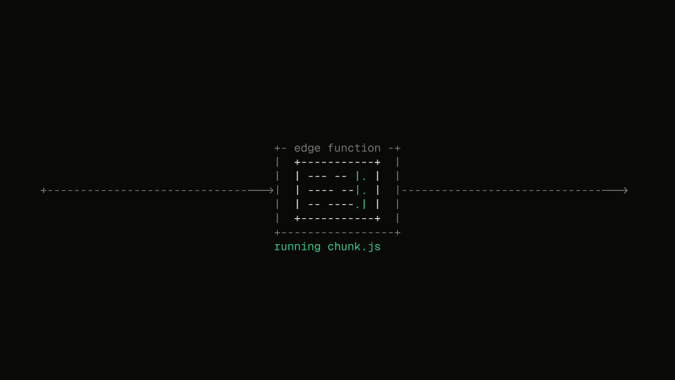

[Original Figma frame](https://www.figma.com/design/LqPL6TBnX15hId7FRjfMOG?node-id=766-35029)

### Parallel activity

This example uses stable typography and position to make overlapping activity
readable. Its labels describe the original subject; do not carry those labels
into an unrelated illustration.

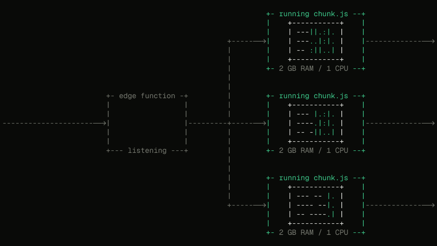

[Original Figma frame](https://www.figma.com/design/LqPL6TBnX15hId7FRjfMOG?node-id=818-4909)

### State and conflict

This example uses repeated structures, a restrained accent, and readable state
labels. Its full readout includes hidden instance descendants as well as the
visible composition.

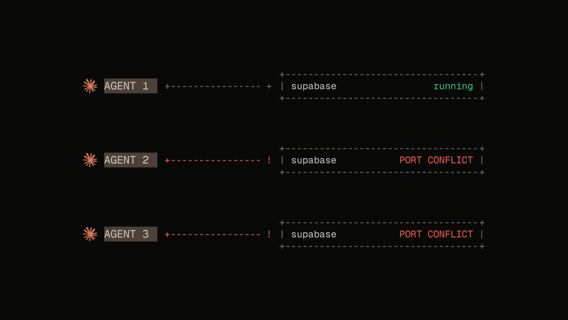

[Original Figma frame](https://www.figma.com/design/LqPL6TBnX15hId7FRjfMOG?node-id=1630-5817)

### Focus and resolution

This example contains stepped focus changes, expansion, substitution, and
restoration. Inspect its keyframes for the sequence; the PNG is a resting
canvas view, not a sampled playback frame.

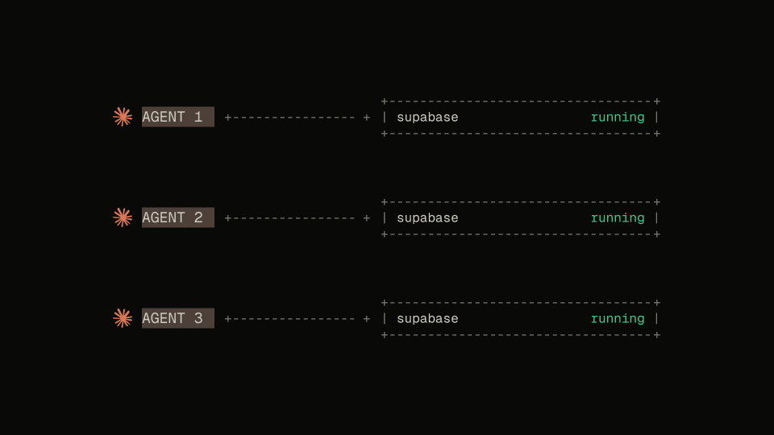

[Original Figma frame](https://www.figma.com/design/LqPL6TBnX15hId7FRjfMOG?node-id=1640-2682)

## Additional visual structures

Use these references when the subject needs a chart, hierarchy, timeline, or
a different kind of activity. The full captures retain source-specific copy
and component documentation for provenance. Those do not expand this skill
into presentation layout or authorize reusing their factual claims.

### Distinct processing roles

The shared branches contain different internal character glyphs for agent
work, API requests, and document processing. Transfer the idea of a stable
route with distinct activities, rather than copying those particular services.

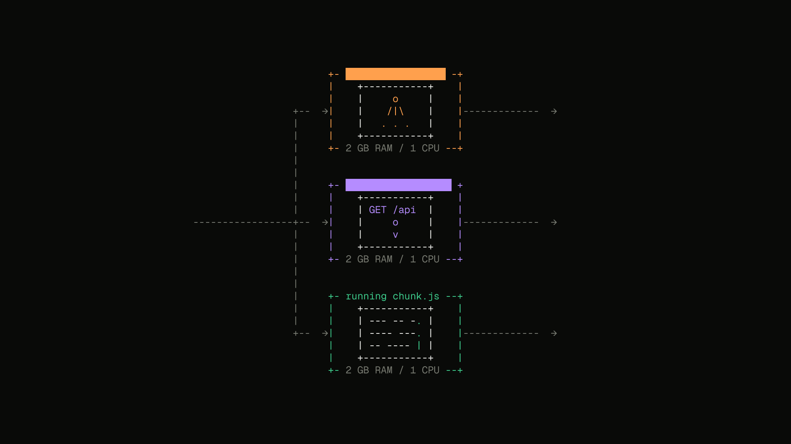

[Original Figma frame](https://www.figma.com/design/LqPL6TBnX15hId7FRjfMOG?node-id=1402-4820)

### Throughput comparison

Character traces use a common grid, axes, units, and legend to compare two
series. The source sequence introduces the traces in stages. Inspect the
tracks for the actual reveal; the resting PNG alone cannot show the order.
The benchmark values and surrounding source-slide copy are specific to this
example. Do not carry them into an unrelated chart.

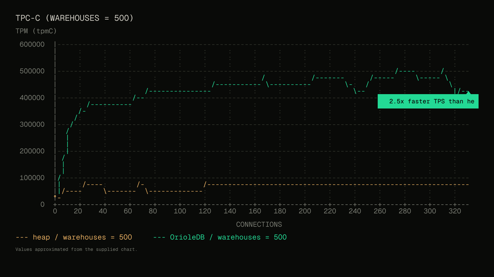

[Original Figma frame](https://www.figma.com/design/LqPL6TBnX15hId7FRjfMOG?node-id=1262-2858)

### Shaded growth area

The `#` field fills the area beneath a character trace. Separate layers hold
the trace, grid, point labels, and reveal masks. Use this construction when
area or accumulation carries meaning, and derive the geometry from the new
task's data. The original project counts are reference content, not defaults.

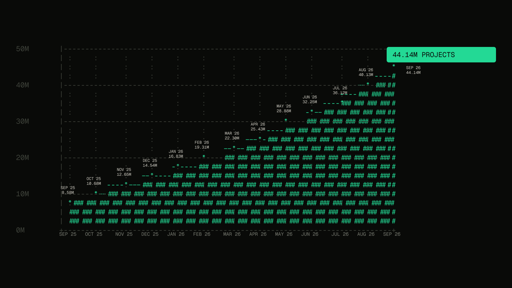

[Original Figma frame](https://www.figma.com/design/LqPL6TBnX15hId7FRjfMOG?node-id=2052-93476)

### Startup and footprint states

This complete section includes startup-sequence variants, a resource-footprint
comparison, and compact and expanded terminal examples. Compare the variants
to understand how stable rows communicate idle, starting, and running states.
Component variants are construction references; their presence alone does
not establish a playable animation.

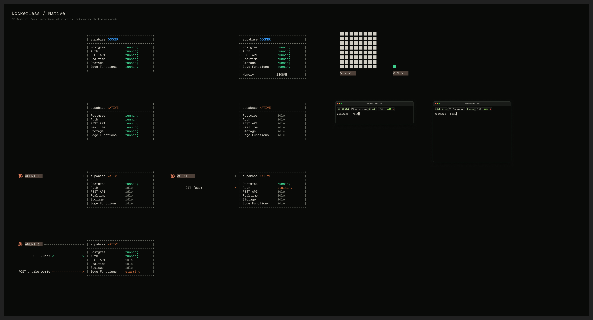

[Original Figma section](https://www.figma.com/design/LqPL6TBnX15hId7FRjfMOG?node-id=650-27035)

### Destination streams

Fixed routes establish the branching topology while separate clipped layers
carry character streams. The source also contains stepped entrance poses.
Its destination logos identify the original products; use the new task's
entities and identities when adapting the pattern.

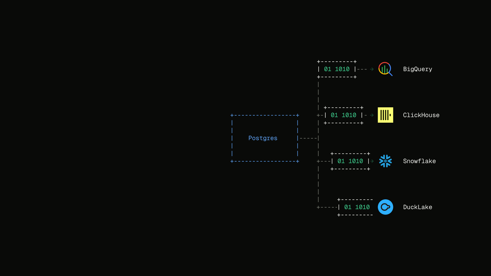

[Original Figma frame](https://www.figma.com/design/LqPL6TBnX15hId7FRjfMOG?node-id=2095-9825)

### Workspace tree

Repeated editable rows preserve the hierarchy, connector columns, and aligned
metadata. Color and row selection distinguish active, queued, completed, and
live states without changing the underlying indentation. This is a static
construction reference; do not infer animation from its containing timeline.

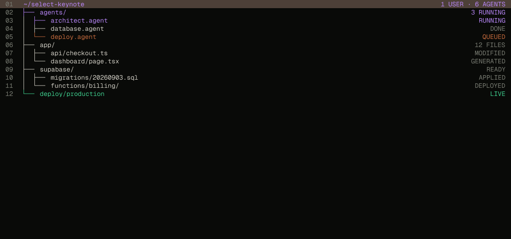

[Original Figma frame](https://www.figma.com/design/LqPL6TBnX15hId7FRjfMOG?node-id=170-981)

### Timeline components

This complete section contains foundations, phase tabs, connectors, markers,
labels, axis arrows, and assembled milestone and clock-time variants. Use it
to study spacing, hierarchy, and state emphasis. It combines monospace labels
with native vector geometry, so it is a companion reference rather than a
strict ASCII-only example. Preserve the distinction between an ordered list
of milestones and a time axis whose positions encode elapsed time.

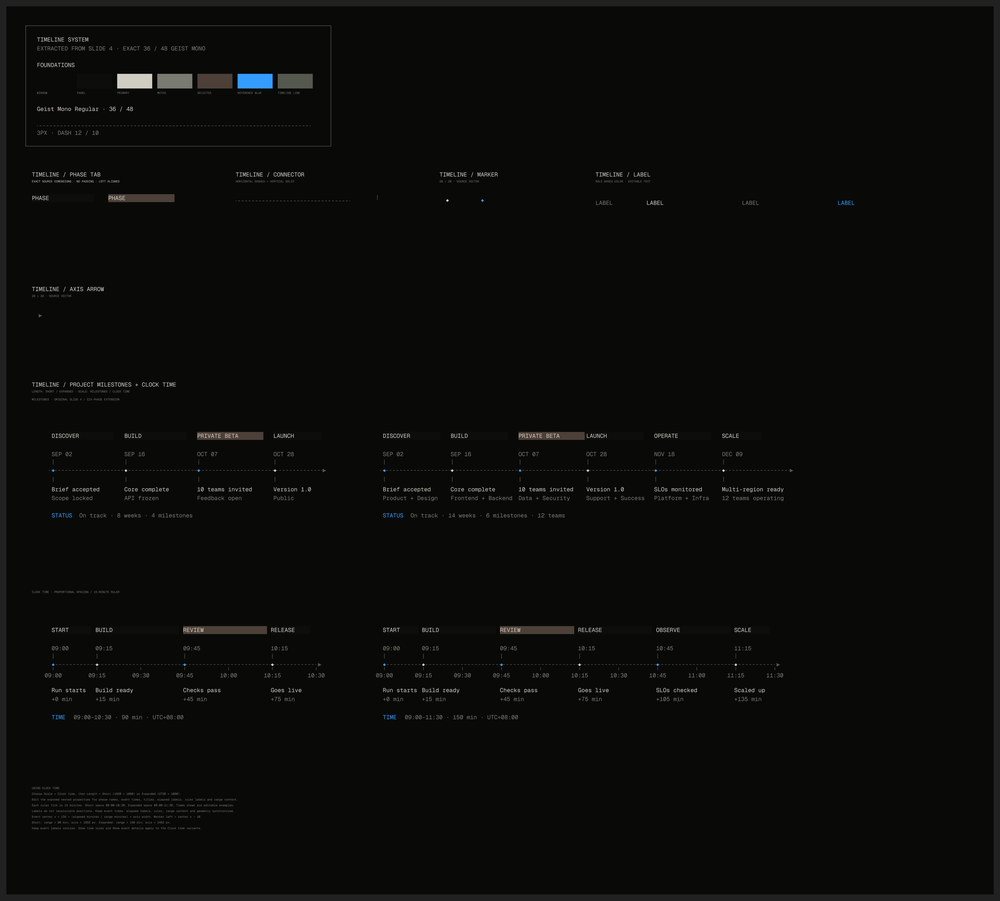

[Original Figma section](https://www.figma.com/design/LqPL6TBnX15hId7FRjfMOG?node-id=104-415)

## Reference profile

These observations describe this collection. Use the user's current design
system when it calls for a different font, palette, canvas, or subject.

- The animation frames commonly use 1920 × 1080 or 2560 × 1440 canvases and
  a dark `#090a08` background. Component boards and trees have other bounds.
  These describe the captured assets; they do not prescribe slide layouts,
  titles, or footers. New assets use caller-supplied or diagram-sized bounds.
- Main art commonly uses Geist Mono Regular at 32px with 40px line height.
  The pose-based examples use approximately 19px character advance. Other
  hierarchy levels have their own metrics; inspect the actual text ranges.
- Quiet gray structure supports brighter content and semantic accents.
  Green and red carry meanings in these source examples. They are not
  mandatory colors for other subjects.
- HOLD transitions dominate the character poses and state changes. The
  processing and chart references also contain linear or eased reveals and
  transitions. Inspect the relevant tracks rather than assuming every field
  uses the same easing. Some examples swap complete poses; others animate
  persistent layers and clipped reveals.
- The startup, workspace-tree, and timeline-component references are static
  construction examples with no captured manual keyframes. A containing
  timeline entry does not make a static component an animation.
- Some sequences loop; others finish on a result or continue a prior shot.
  Read the actual timeline rather than inferring a loop from the style.

## Payload format and completeness

Each JSON is a full captured property readout of its selected container subtree,
not an excerpt of selected poses. It preserves all traversed layers, including
hidden instance descendants, complete text strings, rich text segments,
geometry properties, paint data, manual and resolved animation tracks,
animation styles, and containing timelines. Referenced accessible paint/text
styles and variable definitions are included. `childIds` preserve sibling
order; `parentId` preserves the hierarchy. `FIGMA_MIXED` represents Figma's
mixed-value sentinel without dropping the field.

Each payload records the source file, page, root node, exact source URL, capture
date, property schema, node count, and read errors. The accompanying
[index.json](index.json) records file hashes, image dimensions, and source
identities and the capture date of each example.

Schema version 1 uses `source.frameId` and `source.frameName` for frame roots.
Version 2 uses `source.nodeId`, `source.nodeName`, and `source.nodeType` so
sections and component containers can be retained intact. The validator
supports both versions. Unsupported node properties are absent; for example,
component sets do not expose manual motion tracks in this capture environment.

These are Plugin API readouts. The connector did not support `JSON_REST_V1`
export, so they are not presented as REST responses or `.fig` backups. The
format records its boundaries explicitly:

- Instances contain their rendered descendants; external component master
  definitions are not recursively included.
- Native text, vector paths, vector networks, and shape properties are
  retained. Derived glyph outlines (`fillGeometry` and `strokeGeometry`) are
  not duplicated alongside their source text and font properties.
- Font binaries, image binaries referenced by paint hashes, plugin-private
  data, comments, and version history are outside this readout. The supplied
  PNGs preserve the visible reference. Check `imageHashes` and capture errors
  before claiming another capture is independently reconstructable.

The PNGs show the native resting canvas state. They support visual inspection
of typography and composition, not verification of an arbitrary timeline
moment. Use the complete tracks to understand the motion and verify a newly
built animation through actual playback.

## Read or extend the collection

Use local files when the skill is installed. A harness without a checkout can
fetch files from the repository's raw GitHub URLs; use a commit SHA when
reproducibility matters. A live Figma link is useful for provenance or a newer
version, but must not become a required dependency for these references.

To add a reference, use the current Figma use and motion skills, inspect its
source, and run [capture-figma-reference.js](../scripts/capture-figma-reference.js)
through `use_figma`. Append an invocation with the inspected file, page, and
root node IDs and the capture date. Pass the root as `nodeId`; the helper also
accepts the older `frameId` argument. This reads the source without changing
design nodes. Preserve the complete result instead of copying a few keyframes into a
summary file. Capture a native screenshot and record what state it represents.

When a response limit prevents transferring the result in one call,
[payload-transfer.js](../scripts/payload-transfer.js) packs it losslessly into
bounded chunks. Supply a standard zlib encoder, such as `pako.deflate`, in the
capture environment. This transport dependency is only needed when collecting
new references; reading the skill requires no JavaScript packages. Save every
chunk separately; the default chunk size fits the connector's 20,480-byte
return limit. Then restore the ordinary JSON with:

```sh
node scripts/assemble-reference.mjs <chunk-directory> <stem> <output.json>
```

The assembler rejects missing chunks, mixed captures, and checksum mismatches.
A changed source during capture requires a new coherent set of chunks. Keep
transport chunks in task output, not in the skill. Add the expanded JSON and
PNG to this collection, update the index, and run:

```sh
node scripts/validate-references.mjs
```

Use snippets in explanatory prose when helpful. Keep the actual reference
artifacts complete and load only the examples relevant to the current task.
